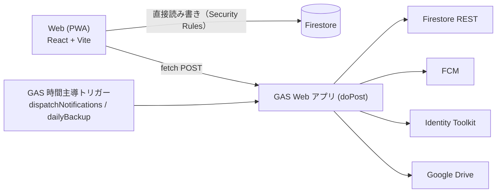

# Baby hub

新生児期の家族が、お世話の記録・予定・健康情報を共有するための PWA です。

## 概要

おむつ・授乳・睡眠などのお世話を数秒で記録し、「誰が何をしたか」と生活リズムを一目で共有できます。予定・ToDo・買い物・申し送り・健康情報もまとめ、家族間の引き継ぎを1つのアプリで完結させます。React + TypeScript と Firebaseで動き、サーバー処理は Google Apps Script（GAS）に置いています。

## 主な機能

- 6カテゴリ（おむつ・授乳/ミルク・吐いた・睡眠・沐浴・その他）を数秒で記録、実施者と入力者を区別
- 24時間の生活リズム表と7日比較、出来事の前後の記録を振り返る表示
- 記録の訂正・無効化（訂正履歴の保持）
- 予定（月カレンダー・日別一覧）・ToDo・買い物・家族間の申し送り
- 健康管理（体温・症状・成長・予防接種・受診メモ・薬、レポート）
- 服薬の担当取得と完了・スキップ（二重投与の防止）
- 招待リンクによる家族メンバーの参加、管理者の移譲、退出・除外
- FCM による Web プッシュ通知（申し送り・予定リマインド）
- Google ドライブへの自動バックアップと復元、データのエクスポート
- オフライン対応、信頼端末と共有端末の切り分け

## 構成



- 通常の読み書きは Web から Firestore へ直接行い、`firestore.rules` で保護します。
- 更新・削除、招待、服薬の担当取得、通知、バックアップなどは GAS Web アプリ経由です。
- Firebase は Spark プランで運用します（Hosting / Firestore / Authentication）。サーバー処理は GAS が担います。

## ディレクトリ構成

| パス | 内容 |
| --- | --- |
| `web/` | React + TypeScript の PWA（`src/features/{records,plans,health,account}` に機能別画面） |
| `gas/` | GAS バックエンド（`core`, `family`, `documents`, `medication`, `account`, `notify`, `backup`, `shared`） |
| `firestore.rules` / `firestore.indexes.json` | Firestore のセキュリティルールとインデックス |
| `rules-tests/` | Firestore Rules のテスト（エミュレータ上で vitest） |
| `e2e/` | GAS dev-server とエミュレータによる結合スモークテスト |
| `docs/` | 設計・セットアップ・運用ドキュメント |

## 必要なもの

- Node.js: [.nvmrc](.nvmrc) のバージョン（`nvm use`）
- Java 21（Firestore エミュレータ用）
- Firebase CLI（`firebase`）
- clasp: `gas/` の devDependencies に含まれます（`npx clasp`）

詳しい導入手順は [docs/manual.md](docs/manual.md) の 2 章を参照してください。

## ローカル開発のクイックスタート

```bash
# 依存関係のインストール（初回のみ）
npm --prefix web install && npm --prefix gas install

# 環境変数: web/.env.example を参考に設定する
#   ローカル開発では VITE_USE_EMULATORS=true、VITE_GAS_ENDPOINT=http://localhost:8787 にする

# ターミナル1: エミュレータ（リポジトリルート）
firebase emulators:start --only auth,firestore --project demo-baby-hub

# ターミナル2: GAS ローカルサーバー（Node 上で GAS コアを動かす）
cd gas && npm run dev

# ターミナル3: Web 開発サーバー
cd web && npm run dev
```

- 変数の意味は [web/.env.example](web/.env.example) を参照してください。値は Firebase Console で確認します。
- アプリは http://localhost:5173、Emulator UI は http://localhost:4000 です。
- dev-server の既定プロジェクトは `demo-baby-hub` なので、エミュレータも同じプロジェクトで起動します。
- 手順の詳細と招待フローの確認方法は [docs/manual.md](docs/manual.md) の 8 章を参照してください。

## テスト

| コマンド | 内容 |
| --- | --- |
| `npm --prefix web test` | Web の純粋関数・ロジックの単体テスト（vitest） |
| `npm --prefix web run typecheck` | Web の型チェック |
| `npm --prefix gas test` | GAS コアと各機能の単体テスト（エミュレータ不要） |
| `npm --prefix gas run typecheck` | GAS の型チェック |
| `npm --prefix gas run test:emu` | GAS と Firestore / Auth エミュレータの結合テスト |
| `npm --prefix rules-tests test` | Firestore Rules のテスト（エミュレータを自動起動） |
| `npm --prefix e2e test` | dev-server とエミュレータによる結合スモークテスト |

エミュレータを使うテストは Java 21 が必要で、`demo-baby-hub` プロジェクトを使うため本番には接続しません。詳細は [docs/manual.md](docs/manual.md) の 9 章を参照してください。

## デプロイ・運用

詳細は [docs/manual.md](docs/manual.md)（7・10・13 章）と [docs/gas/README.md](docs/gas/README.md) にあります。要点は次のとおりです。

- **Rules / Indexes**: `firebase deploy --only firestore:rules,firestore:indexes`
- **Hosting**: `npm --prefix web run build` の後に `firebase deploy --only hosting`（本番ビルドでは `VITE_USE_EMULATORS` を true にしない）
- **GAS**: `cd gas && npm run push`（build と `clasp push`）。更新は Apps Script エディタの「デプロイを管理」で既存デプロイを新バージョンにし、`/exec` の URL を固定します。`clasp deploy` / `npm run deploy` は新しいデプロイを作るため初回のみ使います。
- **トリガー**: 初回にエディタで `setupTriggers` を実行して権限を承認し、`dispatchNotifications`（5分毎）と `dailyBackup` を作成します。
- 順序は GAS、Rules / Indexes、Hosting の順です。

## ドキュメント

| ファイル | 内容 |
| --- | --- |
| [docs/manual.md](docs/manual.md) | 手作業セットアップ・運用マニュアル（既知の制限、トラブルシューティング含む） |
| [docs/gas/README.md](docs/gas/README.md) | GAS バックエンドのセットアップ・デプロイ・回数制限 |
| [docs/gas/architecture.md](docs/gas/architecture.md) | GAS 版の設計（開発契約） |
| [docs/gas/notify/README.md](docs/gas/notify/README.md) | 通知（FCM）の設定と仕様 |
| [docs/gas/backup/README.md](docs/gas/backup/README.md) | バックアップと復元 |

その他の機能別 README は `docs/gas/{core,family,documents,medication,account}/` にあります。

## セキュリティ

- Firestore は `firestore.rules` で家族メンバーの役割に応じて保護し、`rules-tests/` で検証しています。
- 更新・削除など権限の確認が必要な操作は GAS 側で ID トークンを検証し、トランザクション内で所属と役割を再確認します。API には uid 単位の回数制限があります。
- Hosting は CSP・HSTS・X-Frame-Options などのセキュリティヘッダを付与します（`firebase.json`）。
- 共有端末では認証とキャッシュを永続化せず、プッシュ通知も信頼端末のみです。
- GAS は所有者アカウントの権限で動くため、そのアカウントの 2 段階認証を必ず有効にしてください。
- 詳細: [docs/manual.md](docs/manual.md) の 12・15 章
- 脆弱性を見つけた場合は、公開の Issue ではなく、GitHub の **Security** タブの「Report a vulnerability」から非公開で報告してください。

## ライセンス

[MIT License](LICENSE) © 2026 kzmcode

`gas/vendor/braces` は上流の braces（MIT License）に修正を加えたもので、同梱の LICENSE に従います。
